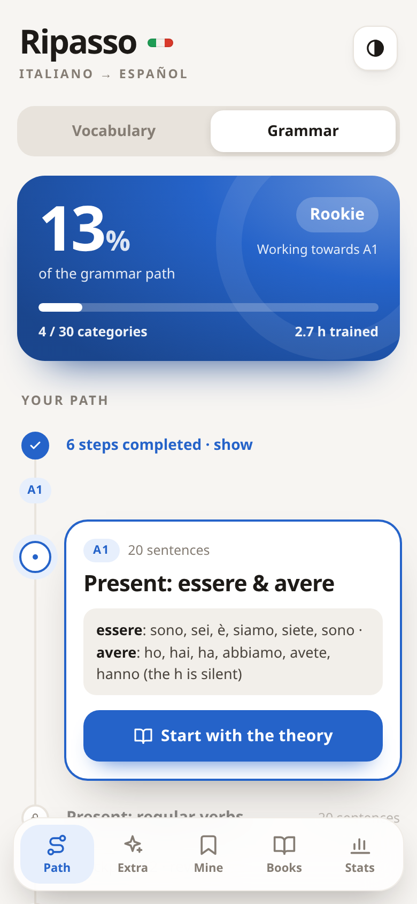
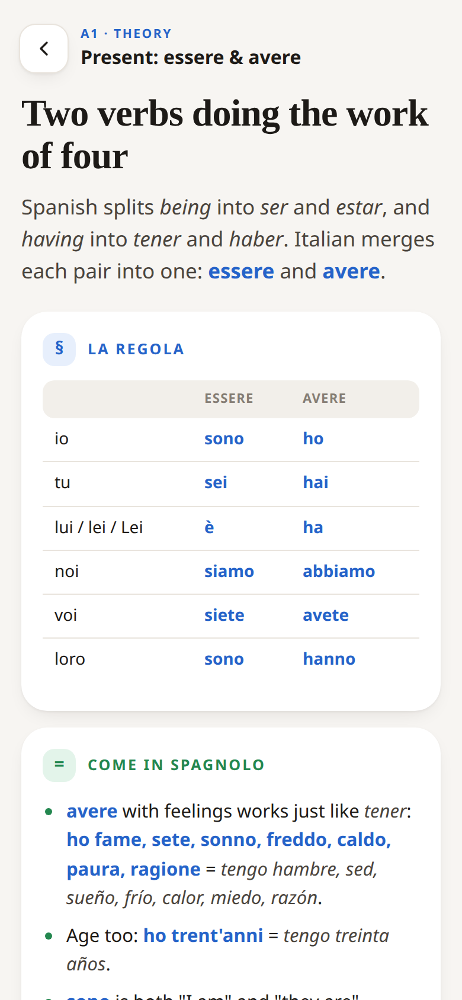
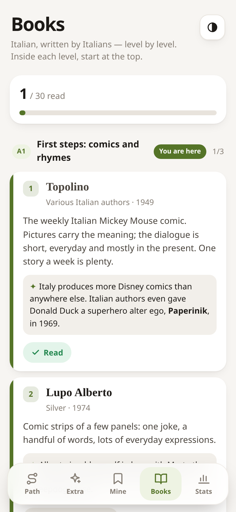

# Language_Practice_Learner

A small, personal app for memorizing **Italian** vocabulary and expressions by translating them into **Spanish (Spain)** — and for drilling Italian **grammar** with gap-fill sentences, each grammar topic introduced by a short **theory** lesson that compares Italian with Spanish. It learns through trial and error — repetition, weighted toward what you get wrong. Built for domestic use, not deployment, and highly customizable.

Memory comes first: this app is a **memorization sustain** — it drills you and keeps bringing back what you fail. The theory lessons give the drills something to stick to; a **reading list** by level points you to real Italian books. Pronunciation and deeper study live elsewhere ([the roadmap](docs/learning-roadmap.md) says what, level by level).

## A look at it

| Your path | The grammar path | A theory lesson |
| :---: | :---: | :---: |
|  |  |  |
| **A gap to fill** | **Books by level** | **Your stats** |
|  |  |  |

---

## Any language pair

This build was made with an **Italian → Spanish** connection in mind, but nothing in the app is tied to those two languages. The vocabulary is just categorized word lists in `docs/data/`, so an **LLM can regenerate the whole set for any language pair** (e.g. German → English, Japanese → French) in the same format — and the app runs unchanged.

---

## How it works (short version)

1. The app shows an Italian word or expression.
2. You type its meaning in Spanish. Checking is **forgiving** — multiple accepted answers, and case/accents/small typos are ignored.
3. If you're right, the Italian hides and you type it **back** from memory (a spelling drill) to advance.
4. Failed words come back more often. You go through categories in order; every 3 categories, two **review rounds** reinforce older words — a normal one (most-missed + random) and a **reverse** one (Spanish → Italian, strict). Review rounds repeat until you clear them in one clean pass, just like categories.
5. **Overrides.** Don't know a word? *I don't know* marks it missed. Sure you were right? *I had it right* cancels that fail and passes the word — without changing the stored answers.
6. A **cumulative timer** tracks your total training time, capped at 30 s per word so idle time never inflates it.
7. **Extra** practice sets sit off the main path (first one: Numbers 0–100), and a **Stats** page shows time per category, tries-to-pass, and your tricky words.
8. **Grammar** is a second path (the **Vocabulary | Grammar** switch on home): an Italian sentence with a gap, a cue and the Spanish meaning — type the missing form (*Ieri Giulia ___ al mare* · *andare* → **è andata**). Checked strictly (accents count), same refill / review / override rules, its own progress; the second checkpoint round hides the cue (**no hints**).
9. **Theory first.** Each grammar category opens with a short lesson: the rule, what works like Spanish, what doesn't, the traps, a curiosity and a trick. It stays one tap away — on the path and inside the drill.
10. **Books.** A reading list from A1 to C2, all originally Italian, with a *to read → reading → read* status per book.

Five screens sit on a floating bar at the bottom: **Path · Extra · Mine · Books · Stats**. The full algorithm — categories, both review rounds, recovery/reset, skip conditions, overrides, the AFK-capped timer, extra categories, the grammar track, theory and books — lives in **[docs/app-concept.md](docs/app-concept.md)**.

---

## Your data

Everything you do is stored **only in your browser on that device** (`localStorage`) — no server, no account, nothing uploaded or shared. Each person who opens the link gets their own independent progress.

- **Stats → Export backup / Import backup** saves your progress to a JSON file and restores it (e.g. on a new phone) — fully manual.
- **Backups from older versions still import.** They restore what they contain and leave whatever they predate (grammar, theory read, reading list) as it is on the device. Updating the app keeps your progress too: vocabulary stays where it always was; everything newer is stored alongside it.
- The app requests **persistent storage** so the browser won't auto-evict your data.
- Clearing the browser's site data or uninstalling still wipes it, so export a copy now and then.

---

## The vocabulary

- Organized into **categories** (colors, food, emotions…), ordered by **CEFR level** (A1 → A2 → B1 → B2+). Level order doubles as difficulty order.
- Each category holds ~30 items; categories over 30 split into subcategories.
- Target Spanish variety: **peninsular (Spain)** — `zumo`, `vaqueros`, `coche`, `fontanero`, etc.
- Category list: **[docs/categories.md](docs/categories.md)**.
- Per-category data files: **[docs/data/](docs/data/)** — one markdown table each (`Italian | Spanish (accepted) | Notes`).

### The dictionary (no duplicates)

**[docs/dictionary.md](docs/dictionary.md)** is an auto-generated, alphabetical master list of every Italian term, used to avoid adding the same word twice. It is built by a script and should **not** be edited by hand:

```bash
python3 scripts/build_dictionary.py
```

Re-run it after changing any category file. It rebuilds the dictionary and flags any duplicates at the top. Rule when a duplicate appears: keep the word in the older category, remove it from the new one, and swap in a fresh word.

> **Item ids are positional** (category number + row), and your fail counts are stored under them. Once a category file has shipped, **don't insert, delete or reorder its rows** — fix typos in place and add new words at the end — or the stored progress lands on the wrong words.

---

## The grammar

- **Categories** follow [docs/learning-roadmap.md](docs/learning-roadmap.md) by CEFR level — **A1 to C1: 59 categories, 1,180 sentences**. List: **[docs/grammar-categories.md](docs/grammar-categories.md)**.
- Per-category files: **[docs/grammar/](docs/grammar/)** — a one-line rule reminder (`> ` line) plus a table `Italian (one ___ gap) | Cue | Answer (accepted) | Spanish | Notes`.
- The Spanish translation is written so that, even with the cue hidden, it settles which form goes in the gap.
- Same id rule as vocabulary: don't insert, delete or reorder rows in a shipped file.
- **Theory lessons:** **[docs/theory/](docs/theory/)** — one per grammar category, same file name. Markdown with a `# title`, a `> ` lead line and six `##` sections: *La regola, Come in spagnolo, Diverso dallo spagnolo, Occhio!, Curiosità, Il trucco* (each becomes a colored card). Supported formatting: `**bold**` (Italian forms), `*italics*` (Spanish forms), lists, tables, `> ` quotes.

---

## The books

**[docs/books.md](docs/books.md)** — books originally written in Italian, by level (A1 → C2) and in the recommended order: one `## <level> · <description>` heading per level, then a table `Title | Author | Year | Why this level | Curiosity`. Your reading status is stored under each book's **title**, so don't rename a title once marked.

---

## Project layout

```
Language_Practice_Learner/
├── README.md                 ← you are here
├── app/                      the PWA (serve this folder)
│   ├── index.html
│   ├── styles.css
│   ├── app.js                UI + drill logic
│   ├── data.json             generated: vocabulary, grammar + theory, books (from docs/)
│   ├── manifest.webmanifest
│   ├── sw.js                 offline service worker
│   └── icon-192.png, icon-512.png   home-screen icons
├── docs/
│   ├── app-concept.md        functionality & algorithm
│   ├── categories.md         master category list (by CEFR level)
│   ├── grammar-categories.md master grammar category list
│   ├── learning-roadmap.md   grammar concepts per CEFR level
│   ├── dictionary.md         auto-generated index of all Italian terms
│   ├── books.md              the reading list, by level
│   ├── data/                 per-category word files (a1-01-numbers.md, …)
│   ├── grammar/              per-category sentence files (a1-01-definite-articles.md, …)
│   └── theory/               one theory lesson per grammar category (same file names)
├── pictures/                 screenshots for this README
└── scripts/
    ├── build_dictionary.py   regenerates docs/dictionary.md
    └── build_data.py         regenerates app/data.json (vocabulary, grammar, theory, books; validates the tables)
```

---

## Status

- **Data:** A1, A2 and B1 complete, B2 in progress — **50 categories, 1,500 terms** so far (0 duplicates). More B2+ themes still to add.
- **App:** **built** — a no-build PWA in [app/](app/): category path (sequential unlock, completed steps folded), progress hero, level badge, AFK-capped timer, the drill loop with forgiving checking + reverse-spelling, **review rounds** every 3 categories *plus a reverse round* (Spanish→Italian, strict), recovery/reset, **I don't know** / **I had it right** overrides, **Extra categories**, **Mine**, **Books** and **Stats** — on a floating bottom bar. Light/dark themes, a color per area. All saved locally.
- **Grammar:** a second path in the app — **A1 to C1 complete (59 categories, 1,180 gap-fill sentences, 59 theory lessons)**, plus two grammar Extra sets (prepositions + articles, irregular participles). [docs/learning-roadmap.md](docs/learning-roadmap.md) lists the concepts to study per CEFR level.
- **Books:** 30 Italian books from A1 (comics, nursery rhymes) to C2 (Manzoni, Dante, Gadda).

## Running it

It's a static PWA — regenerate the data, then serve the `app/` folder:

```bash
python3 scripts/build_data.py                 # rebuild app/data.json after editing vocabulary or grammar
python3 -m http.server 8137 --directory app   # then open http://localhost:8137
```

On Android, host `app/` (e.g. GitHub Pages) and use **Add to Home Screen** to install it offline.

## Stack

A **PWA** (installable, offline) — runs on Android from the home screen, no server needed. Built as a **no-build PWA** (plain HTML/CSS/JS, zero toolchain) with the vocabulary shipped as a local `data.json`. See [docs/app-concept.md](docs/app-concept.md) for the reasoning.
